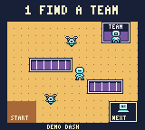

# Demo Dash — Hackathon Hero: Drone Dodge

A top-down Game Boy Color adventure: win a hackathon while dodging drones.
Created with the ModRetro Chromatic plugin and GB Studio.

## Play

Download [the four-room ROM](roms/demo-dash-four-rooms.gbc) and open it in a
Game Boy Color-compatible emulator. The cartridge is a 128 KiB, color-only
MBC5 ROM. Physical ModRetro Chromatic hardware has not been tested.

- D-pad: move.
- A: talk, use a station, and advance dialogue. Approach stations from below
  and face them.
- B: view the objective checklist.

Keyboard mappings depend on your emulator. The ModRetro browser player uses
arrow keys to move, Z for A, and X for B.

## Four rooms

1. **Finding a teammate:** recruit a partner in a lounge with sofa bottlenecks.
2. **Coming up with an idea:** navigate whiteboard islands to the idea board.
3. **Making it work:** collect power, then fix the prototype among server racks.
4. **Demo time:** cross audience aisles and present at the trophy stage.

Each room has two drone patrols. NEXT unlocks after the room's objective is
complete. Drone bumps return you to that room's check-in and preserve progress.
The original one-room hall remains in the source as an unlinked reference.

## Edit and build

Open `project.gbsproj` in GB Studio. This project was built with GB Studio CLI
4.3.2. Source resources are in `project/`; native pixel assets are in `assets/`.
Use GB Studio's ROM export to build a Game Boy Color cartridge. The ModRetro
plugin can also select this project, build the ROM, and run emulator playtests.

## Verification

The exact included ROM was played from a clean boot to victory in PyBoy 2.7.0.
All three room transitions, the locked first exit, the power prerequisite,
progress retention after drone bumps, and the final 4/4 victory were observed.
See [the playtest summary](docs/PLAYTEST.json).

The GIF contains real retained emulator frames, held at native game timing;
it omits pauses spent choosing inputs and does not interpolate missing frames.
Audio and physical Chromatic hardware were not tested.

## License and credits

MIT licensed; see [LICENSE](LICENSE). The room layouts, laptop, trophy, drone
art, palettes, and gameplay events were authored for this game. The player,
fixed-width font, dialogue UI, and native starter are derived from the ModRetro
starter. Its original Chris Maltby MIT copyright notice is preserved.
